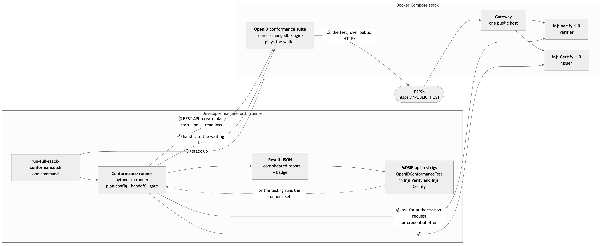

# MOSIP Decode 2026 — PS1: Automated Conformance Testing

Automated conformance-testing harness for **Inji Certify** and **Inji Verify** against the
OpenID Foundation conformance suite.

**Team**: Shardul Chogale (conformance engine and evidence) · Mukta Varak (platform and delivery)

**Problem statement**: *Automated Conformance Testing for Inji Certify and Inji Verify
against OpenID Suite* (Medium complexity)
**Status** (26 Oct): all five mandatory tasks done and demonstrated on a live stack; see
[docs/STATUS.md](docs/STATUS.md) for each requirement, its evidence and what is left.

Work is divided by skill into two halves that meet at a single JSON contract, split roughly
evenly between us — see [the contribution split](docs/PLAN.md#contribution-split) for the
per-task breakdown and how it maps onto the problem statement's deliverables.

---

## What this is

Inji Certify issues verifiable credentials; Inji Verify checks them. Both claim to follow
OpenID standards (OpenID4VCI for issuance, OpenID4VP for presentation). The OpenID
Foundation publishes a **conformance suite** that checks whether an implementation actually
obeys the spec it claims to — but today that suite is driven by hand, one click at a time,
through a web UI.

This project replaces the human with a script: spin up the components and the suite, drive
the suite's REST API to run the issuer and verifier plans, and feed the results into each
module's existing `api-testrig` so conformance becomes a gate on every release.



How it works, in detail: [docs/ARCHITECTURE.md](docs/ARCHITECTURE.md).

**Quick start**, once the per-developer settings below are in place:

```bash
./run-full-stack-conformance.sh --combined      # or --component verify | --component certify
open results/report/report.html                 # the consolidated report
```

That one command brings the stack up, runs the plans, writes `results/conformance.json` and
the report, and shuts the stack down. Its exit status is the gate's verdict.

---

## Documentation

**Start with the [Project Handbook](docs/handbook/handbook.pdf)** — the clean guide to
running everything from a fresh machine to shutdown, a record of every step taken, and
the day-by-day planner to the **2 November** deadline (extended from 26 October). Source: `docs/handbook/handbook.tex`.

| Document | What it covers |
|---|---|
| [docs/handbook/handbook.pdf](docs/handbook/handbook.pdf) | **Start here.** Mentor brief, start-to-end guide, record of steps, planner |
| [docs/STATUS.md](docs/STATUS.md) | **Where we stand** against every requirement of the problem statement, with evidence |
| [docs/ARCHITECTURE.md](docs/ARCHITECTURE.md) | Architecture, how the API automation works, the per-component handoff, the gate, the testrig bridge |
| [docs/SELF-CERTIFICATION.md](docs/SELF-CERTIFICATION.md) | From this harness to an OpenID Foundation certification |
| [docs/TROUBLESHOOTING.md](docs/TROUBLESHOOTING.md) | Problems we hit and their fixes |
| [docs/SETUP.md](docs/SETUP.md) | First-time install of Docker, ngrok and the clones (its stack sections predate Compose) |
| [docs/RUNBOOK.md](docs/RUNBOOK.md) | The pre-Compose stacks, kept for the 0.18.2 evidence |
| [docs/PLAN.md](docs/PLAN.md) | Four-week plan and role split |
| [docs/CONTRACT.md](docs/CONTRACT.md) | The runner→testrig JSON contract |
| [docs/WEEK2.md](docs/WEEK2.md) | Day-by-day build plan for the conformance runner |
| [docs/findings/findings.tex](docs/findings/findings.tex) | Dated findings log, failure catalogue, open questions for mentors |

Build the findings PDF:

```bash
cd docs/findings && pdflatex findings.tex && pdflatex findings.tex
```

---

## Running the harness

You need Docker, Python 3 (tested with 3.13), an ngrok account with a free static domain, and this repo
cloned next to the OpenID conformance suite (only for its key-generation script):

```bash
git clone https://github.com/shard-c6/mosip-decode-ps1.git
git clone --depth 1 https://gitlab.com/openid/conformance-suite.git   # sibling folder
cd mosip-decode-ps1
python3 -m pip install -r requirements.txt
```

### Per-developer settings (once; all gitignored)

Both components put their public address into what the suite must reach, so each developer
uses their own ngrok domain and their own test keys. Replace `YOUR-NGROK-DOMAIN` throughout.

```bash
cp docker/.env.example docker/.env                       # set PUBLIC_HOST=YOUR-NGROK-DOMAIN
cp configs/runner.local.example.json configs/runner.local.json   # replace YOUR-NGROK-DOMAIN, YOURNAME
mkdir -p configs/keys
python3 ../conformance-suite/scripts/generate-vp-test-cert.py --hostname YOUR-NGROK-DOMAIN \
  --output configs/keys/vp-signing-jwk.json --ca-output configs/keys/vp-test-ca.pem   # verifier plan
python3 scripts/generate-client-jwks.py                  # issuer plan's two wallet clients
```

### Run

```bash
ngrok http --url=https://YOUR-NGROK-DOMAIN 3000          # in another terminal (or pass --tunnel)
./run-full-stack-conformance.sh --combined               # or --component verify | --component certify
open results/report/report.html
```

Compare two runs with `python -m runner.diff results-before.json results/conformance.json`.

With the stack already up (`scripts/stack.sh up verify|certify|combined`), run just the
plans with `./run-conformance.sh --component verify|certify` or `--combined`, and stop the
stack with `scripts/stack.sh down`. Problems: [docs/TROUBLESHOOTING.md](docs/TROUBLESHOOTING.md).

Exit status is the gate's verdict: `0` when nothing regressed against the recorded
baseline, `1` on a regression or a harness error, `2` on a configuration error.

CI (`.github/workflows/full-stack-conformance.yml`) runs the harness's tests and validates
the stack on every push. The full conformance run (verify, certify or combined) runs on
demand and weekly once `PUBLIC_HOST` and `NGROK_AUTHTOKEN` are added as repository secrets.

**Results on Inji Certify (release-1.0.x):** the 15-module OID4VCI 1.0 issuer plan runs unattended
(pre-authorized code, SD-JWT, DPoP): 3 pass, 3 skip for features Certify doesn't offer, and the
rest fail for four reasons now documented as findings F-12 to F-15. Bring it up with
`scripts/stack.sh up certify` (or `combined`) and run `./run-conformance.sh --component certify`.

**Both together:** `scripts/stack.sh up combined`, then `./run-conformance.sh --combined` runs
both plans in one go and gates them as one run (26 modules; each component's results identical
to its standalone run).

**In MOSIP's api-testrig:** an `OpenIDConformanceTest` TestNG class, on branch
`feature/openid-conformance-test` of [shard-c6/inji-verify](https://github.com/shard-c6/inji-verify/tree/feature/openid-conformance-test/api-test)
and [shard-c6/inji-certify](https://github.com/shard-c6/inji-certify/tree/feature/openid-conformance-test/api-test),
reports each conformance module and the gate as a test, from a result file or by running the runner.

**Results on Inji Verify 1.0.0-alpha.1** (suite build of 27 October, pinned): 11 of the 12
modules the OID4VP 1.0 Final verifier plan has for our variant are consistent with conformance;
one finds a real defect, F-16: a revoked credential is accepted. Details in
`docs/findings/findings.tex`.

```bash
python3 -m pytest tests/ -q
```

## Repository layout

```
docker/        the Compose stack: suite + Inji Verify + Inji Certify (profiles), gateway, configs
.github/       CI: harness tests and stack validation; on-demand and weekly conformance run
runner/        the conformance runner — suite client, component clients, handoff, gate, report
tests/         unit tests (run without Docker; normalisation uses the real Day 1 log)
docs/          setup, runbook, plan, contract, week plan, findings (LaTeX)
logs/          exported conformance suite logs, by date — our evidence
scripts/       stack.sh (stack up/down/status), key generation, tooling
configs/       runner config, test plan configurations, the contract fixture and baseline
```

This repo holds **our** work. The upstream code lives in sibling clones — see SETUP.md.

---

## Upstream repositories

| Repository | Role |
|---|---|
| [mosip/inji-verify](https://github.com/mosip/inji-verify) | Verifier under test |
| [mosip/inji-certify](https://github.com/mosip/inji-certify) | Issuer under test |
| [mosip/mosip-functional-tests](https://github.com/mosip/mosip-functional-tests) | `api-testrig` framework we integrate into |
| [openid/conformance-suite](https://gitlab.com/openid/conformance-suite) | The conformance suite itself |
| [conformance-suite-automated-testing-tutorial](https://gitlab.com/openid/conformance-suite-automated-testing-tutorial) | OpenID Foundation's own automation worked example |

### Our forks

The `OpenIDConformanceTest` work lands on branches of these forks, shaped so each could be
opened as an upstream pull request. `api-test/` lives inside `inji-verify` and
`inji-certify` — not in `mosip-functional-tests`, which carries only `apitest-commons`.

- Shardul: [inji-verify](https://github.com/shard-c6/inji-verify) ·
  [inji-certify](https://github.com/shard-c6/inji-certify) ·
  [mosip-functional-tests](https://github.com/shard-c6/mosip-functional-tests)
- Mukta: <!-- TODO: add once her forks exist -->

---

## Findings so far

> **Version note (2 October).** These findings are against Inji Verify **0.18.2**. Upstream's
> Inji 1.0 line — the version the problem statement targets — already fixes the nonce and
> implements DCQL. They stand for 0.18.2 and are on hold for upstream reporting until
> re-checked against 1.0. The harness baseline is moving to `1.0.0-alpha.1`.

Nine findings catalogued against Inji Verify 0.18.2 on day one, eight confirmed with
evidence from the OpenID Foundation's own conformance suite. Headlines:

- **Nonce has insufficient entropy** — it is a base64-encoded millisecond timestamp rather
  than a random value. Confirmed independently by the suite: 73.68 bits of Shannon entropy
  against a 96-bit threshold.
- **No DCQL support** — Verify implements the superseded Presentation Exchange query model,
  so no module in the OID4VP 1.0 Final verifier plan can complete.
- **No `direct_post.jwt`** — response mode is a hardcoded constant, so HAIP certification is
  currently impossible.

Full catalogue with evidence, severity and spec references in the findings document. Each
finding is tagged CONFIRMED or UNVERIFIED; nothing is reported upstream until it is
reproducible and the root cause is understood.

---

## License

Source contributions are intended for upstream donation to MOSIP on request, per the
MOSIP Decode rules.
