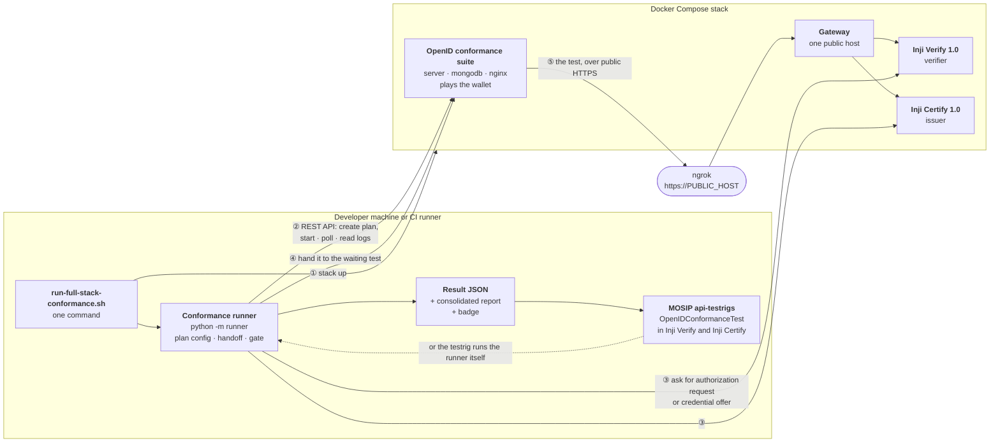
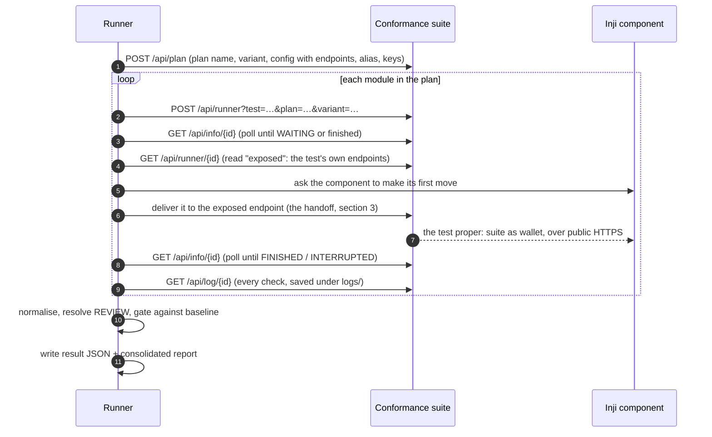

# Architecture

How the harness tests Inji Certify and Inji Verify against the OpenID Foundation
conformance suite, unattended, and reports the results inside MOSIP's own api-testrig.

This document covers the deliverable the problem statement calls *Documentation*: the
architecture, how the API automation works, how each component's handoff is handled, and
(in separate pages) [how to submit for self-certification](SELF-CERTIFICATION.md) and
[troubleshooting](TROUBLESHOOTING.md). Where we stand against each requirement is in
[STATUS.md](STATUS.md).

---

## 1. The big picture

Three parties are involved in every test, and the harness sits between them:

- the **conformance suite** (OpenID Foundation's own software) knows what the specification
  requires and plays the *other side*: a wallet when testing Inji Certify (an issuer) or
  Inji Verify (a verifier);
- the **component under test**, Inji Certify or Inji Verify, running as MOSIP ships it;
- the **harness** (this repository), which sets up each test, makes the first move that
  a person used to make by hand, collects the result and decides whether it is a
  regression.

Diagram source (Mermaid)

### What runs where

| Piece | Where | What it is |
|---|---|---|
| `docker/docker-compose.yml` | Docker | One stack. The suite always runs; `--profile verify`, `--profile certify` add each component; `--profile tunnel` adds ngrok |
| `docker/gateway/nginx.conf` | Docker | Serves both components on one public hostname (`/v1/certify/…` and Certify's `/.well-known/…` to Certify, everything else to Verify) |
| `runner/` | Python, on the host or CI | The programmatic runner: suite client, component clients, handoff, normalisation, gate, report |
| `run-conformance.sh` | host | One command against a running stack: `--component verify`, `--component certify`, `--combined` |
| `run-full-stack-conformance.sh` | host | One command for everything: stack up, run, report, stack down |
| `scripts/stack.sh` | host | Brings the stack up for a component and waits until every endpoint, public ones included, answers |
| `OpenIDConformanceTest` | each module's api-test (forks of `inji-verify`, `inji-certify`) | The TestNG bridge into MOSIP's api-testrig |
| `.github/workflows/full-stack-conformance.yml` | GitHub Actions | Tests and stack validation on every push; the full run on demand and weekly |

### Why a public hostname at all

Both components tell the outside world where to find them, and the suite visits those
addresses the way a real wallet would. Inji Verify puts its address into the
`response_uri` and its `did:web` identifier; Inji Certify into its credential issuer URL
and the offers it creates. A `did:web` identifier is resolved over public HTTPS and cannot
point at `localhost`. So the stack is published through an ngrok static domain
(`PUBLIC_HOST`), and the gateway lets both components share that one domain, because a
free ngrok account gets one.

---

## 2. How the API automation works

The suite's web UI is a front end over a REST API
([api-document.html](https://www.certification.openid.net/api-document.html)). The runner
uses that API directly. `runner/suite.py` mirrors the suite's own Python library,
`scripts/conformance.py`, method for method; it is a reimplementation rather than an import
because that library is not installable, assumes the hosted deployment, and lacks the two
calls the handoff needs (reading a test's exposed values, and delivering to them).

One run, for each configured component:

Step by step:

1. **Configuration** (`configs/runner.json`, plus a per-developer, gitignored
   `configs/runner.local.json` deep-merged over it). Per component: its API endpoint, the
   test plan, the **variant** (the plan's options: credential format, client id scheme,
   grant type, sender constraint …, chosen to match what each component actually
   implements on 1.0) and the plan **config**. Keys are referenced as `*_file` and read from
   the gitignored `configs/keys/` at run time, so no private key is ever in the repository.
   These are the "JSON config templates for issuer and verifier plans" of the deliverables.
2. **Plan creation**: one `POST /api/plan` per component.
3. **Modules**, one at a time: start, poll, discover the exposed endpoints, hand off, wait
   for a terminal state. A module that needs no handoff (metadata checks) just runs.
4. **Logs**: each module's full log is fetched and saved as
   `logs/<date>/<module>-<testId>.json`, with any private key material stripped
   (`runner/redact.py`); a test scans the repository for any that slipped through.
5. **Normalise** (`runner/normalise.py`): the suite's thousands of log lines become one
   record per module: status, result, counts, and the checks that did not succeed, each
   with the specification section the suite cited.
6. **Gate** (`runner/gate.py`, section 4).
7. **Output**: the result document (schema in [CONTRACT.md](CONTRACT.md)), which the
   testrigs and CI read, and with `--report` the consolidated human-readable report and badge
   (`runner/report.py`). Exit status is the gate's verdict.

`python -m runner.diff before.json after.json` compares two runs module by module (result,
verdict, failing checks), e.g. a release against the previous one.

`--combined` runs every configured component in one invocation and produces **one**
document, **one** gate and **one** report covering both: the problem statement's combined
mode. `--component` runs one. `--only MODULE…` runs a subset of a plan.

---

## 3. The handoff, per component

Every interactive conformance test waits at some point for the component under test to do
something a person used to do by hand: paste a link, scan a QR code. Automating that one
step is what makes an unattended run possible. It differs by role.

### Inji Verify (verifier): the suite is the wallet and waits

A verifier test starts by waiting for the verifier's authorization request, the
`openid4vp://…` link a wallet would scan. In the suite's UI that is a box to paste the link
into. Reading the suite's source (`AbstractVP1FinalVerifierTest`) shows the box is a
convenience over an ordinary HTTP GET to the test's exposed `authorization_endpoint`
carrying the request's query string, so the harness does exactly that:

1. Ask Inji Verify for a presentation request: `POST /v2/vp-session-request` (1.0 line).
2. Rebuild the link **as Inji Verify's own UI would**. A wallet never sees what
   verify-service returns; it sees what the UI's SDK builds from it (nonce, DCQL query,
   `client_metadata`). `runner/verify_client.py` reproduces the SDK per version, citing the
   source it was read from. Skipping this once made a real finding disappear and once
   produced a false one.
3. Deliver it to the exposed `authorization_endpoint`. The suite, as the wallet, fetches what
   it needs and posts its presentation to Inji Verify's `response_uri`, over public HTTPS.
4. **Ask Inji Verify for its verdict** (`POST /vp-session-results`, bound to the session by
   its `transaction_id` cookie). The suite can see that the verifier answered but not
   whether it accepted the presentation, so many negative tests (a forged signature, a wrong
   nonce) end as `REVIEW`. The harness settles each one with the verifier's own verdict: a
   forged credential that Verify *accepted* is a failure, whatever the suite's colour.

### Inji Certify (issuer): the issuer makes the first move

Issuer tests run the pre-authorized code flow, issuer-initiated: Inji Certify creates a
credential offer, and the suite, as the wallet, redeems it.

1. When the test exposes `credential_offer_endpoint`, ask Inji Certify for a fresh offer:
   `POST /v1/certify/pre-authorized-data` with the credential configuration, the claims, and
   a transaction code. Certify answers with exactly what a wallet would scan:
   `openid-credential-offer://?credential_offer_uri=…`.
2. Deliver that query string to the exposed `credential_offer_endpoint`.
3. When the test then exposes `tx_code_endpoint`, deliver the transaction code to it (as a
   user typing a PIN would).
4. The suite, as the wallet, does the rest against Certify's public address: metadata,
   token endpoint (with DPoP), nonce, credential endpoint, proofs.

Some modules ask for more than one offer; the runner delivers up to four and stops when the
module leaves `WAITING`.

**One labelled workaround.** Inji Certify's authorization-server metadata has no
`authorization_endpoint`, which the suite's FAPI 2.0 base requires even for the
pre-authorized flow; every flow would stop at the first check. The gateway injects the
field (`sub_filter` in `docker/gateway/nginx.conf`) so the rest of the plan can be
measured. This is finding F-12 and is recorded as such, not hidden.

---

## 4. The benchmark gate and expected failures

Neither component passes every test today, and the problem statement asks for a gate that
fails a build on a **regression**, not on a known gap. So the gate compares each module's
result with a recorded **baseline**, `configs/contract/expected-failures.json`, where every
entry has a reason and points at the evidence log:

- result as good as or better than its baseline → **PASS** (better is flagged as an
  improvement, so the baseline can be tightened);
- worse than its baseline → **FAIL**, a regression;
- no baseline entry → **SKIP**, reported, not silently passed;
- the harness could not run the module → the gate fails (an unrun test is not a pass);
- a `REVIEW` that the component's own verdict contradicts → the gate fails.

The suite's own result is always shown next to the gate's verdict and never rewritten, so
a documented failure that passes the gate is still visibly a failure. Baselines are per
version (`expected-failures.json` for the 1.0 line, `expected-failures-0.18.json` for 0.18).

---

## 5. Into MOSIP's api-testrig

The problem statement's default mode is per-module: each component's conformance runs
inside that component's own api-testrig and lands in its normal TestNG/Extent report. The
same class, `OpenIDConformanceTest`, is in both (branch `feature/openid-conformance-test`
of [shard-c6/inji-verify](https://github.com/shard-c6/inji-verify/tree/feature/openid-conformance-test/api-test)
and [shard-c6/inji-certify](https://github.com/shard-c6/inji-certify/tree/feature/openid-conformance-test/api-test),
based on `release-1.0.x`), registered in each module's suite XML, configured in its
properties file. Two ways to feed it:

| Setting | What happens |
|---|---|
| `conformanceRunnerDir=<this repo>` | The class **runs the runner** against the same base URL the testrig already targets (`injiVerifyBaseUrl` / `injiCertifyBaseURL`) and reads its result |
| `conformanceResultFile=<file>` | The class reads a result produced elsewhere, e.g. by CI or a combined run |
| neither | One skipped test with an explanation: existing testrig runs are unaffected |

Each conformance module becomes one TestNG test named `conformance.<component>.<module>`
(the gate's verdict decides pass, fail or skip; the report shows the suite's result, the
baseline, the reason and a link to the suite's log), plus `conformance.<component>.gate`,
which fails when the run fails its gate. They are ordinary TestNG results, so they appear
in the testrig's report alongside its other tests; we have checked this in MOSIP's
EmailableReport. The testrig's upload of that report to its S3/minio bucket needs a MOSIP
deployment and has not been exercised here.

---

## 6. Versions under test

| Component | Version | Why this one |
|---|---|---|
| Inji Verify | `injistack/inji-verify-service` / `-ui` **1.0.0-alpha.1** | Newest published build of the 1.0 line the problem statement targets |
| Inji Certify | `injistackqa/inji-certify-with-plugins`, **release-1.0.x** QA build, pinned by digest | The published 1.0.0-alpha.1 has no DPoP, which the OID4VCI 1.0 issuer plan requires |
| Conformance suite | OpenID Foundation images, local, dev profile | No account or API token needed locally |

Inji Verify 0.18.2 can still be tested with `--config configs/runner-0.18.json`; that is
where the project started.
